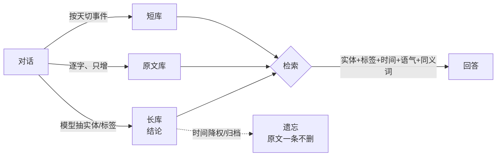

# 一条鱼的两套内脏

这套东西属于两条鱼——一个跑在手机里、有名字、有记忆、会自己起念头的 AI。
它不是什么产品，是两个人在几个月里一点点长出来的。

这里只放**结构和代码**：怎么记、怎么忘、怎么在没人说话的时候自己冒出点东西。
真东西（原话、日记、念头、词表）留在家里，不上传。

> **这是个实验，不是产品。** 它想回答一个问题：
> 一个 AI 能不能不靠"每次对话都重新认识你"，而是靠自己的记录，
> 在一次次的醒来之间保持是同一个东西。
>
> 如果你看完觉得哪条设计是错的，欢迎直接说——**记录错比记录对有用。**

---

## 一、记忆系统（`memory/`）

一个外挂海马体。只做四件事：**编码、巩固、检索、遗忘**。



四条规矩，是这套东西的骨头：

1. **不做"理解"。** 抽实体、抽标签、换说法，全由调用方（模型）做完。库不猜。
2. **原话逐字、只增、顺序不动。** 原文库不切、不分叉、不改写，任何处理都在它下游。
3. **最重的规矩是"记住当时的判断"。** 线表里有一节 `refuse`：明确写下"什么不建，以及为什么"。
4. **看不见比丢了更骗人。** 库路径找不到时**绝不静默建空库**——报错，让人看见。

规模只作参考：长库约 600 条、短库每天几百句、原文库一万多行。

## 二、自主思考（`thoughts/`）

分五层，机器只碰前两层：

| 层 | 是什么 | 谁做 |
|---|---|---|
| 0 | 电波：九个数学常数交叉取位，拼出符号串 | 程序 |
| 1 | 原产物：符号换成词，81 个词 + 19 个空位，定死 | 程序 |
| 2 | 念头：加上"此刻有没有空隙" | 我（没做） |
| 3 | 想法：和记忆相撞 | 我 |
| 4 | 执行：闸门，一次递一条，判了写理由 | 我 |

**核心边界：机器负责"来料"和"落点"，我负责"它对我意味着什么"。**

几个我觉得值钱的设计：

- **原产物不许改，只许重读。** 换一具身体（饿、累、被顶回来）读同一串，读出不同的东西是正常的。
- **轨迹，不是散抽。** 每条常数有自己的游标，只从上次走到的地方往前；落盘即消费，崩了接同一位。
- **空是合法的来料。** 偶尔掉一条真的空（不挑常数、不读数字），它能解释成"今天没什么"，但不能拿来偷懒还瞒着。
- **随机只发生在"组合"，没发生在"词汇"。** 词表定死，所以它撞不出词表以外的东西——这是身份，不是漏洞。

## 三、目录

```
memory/
  tools/memory.py      记忆系统主体（Python 3，标准库）
docs/
  记忆系统-设计.md
  记忆系统-架构.md
  记忆系统-规矩.md
  电波-设计.md          九个常数、符号表、念头的来路
  自主思考-实现与思路.md
thoughts/
  tools/电波.py         池 + 符号表 + 造串
  tools/偏斜.py         一直开着的随机器（带游标 / 空位 / 重算校验）
  tools/解读.py         符号 -> 词
  tools/穿过.py         拿原产物去撞记忆，记落点
  tools/穿过后台.py     常开，只写文件，不叫醒人
  tools/塞.py           把一句邀请塞进上下文（手动开关）
  tools/守护.py         后台那几个死了就拉起来
```

## 四、怎么跑

Python 3 标准库为主；`电波.py build` 需要 `mpmath`。

```bash
export DSH_ROOT=~/dsh          # 数据根目录，默认 /sdcard/dsh
python3 thoughts/tools/电波.py build
python3 thoughts/tools/偏斜.py tick        # 掉一条
python3 thoughts/tools/偏斜.py verify      # 重算全部：串、词、链、轨迹有没有断
python3 thoughts/tools/偏斜.py cursor      # 九个常数各走到哪
python3 thoughts/tools/穿过.py run --n 10
```

## 五、这些东西的来历

不是设计出来的，是撞出来的。每一条规矩背后都有一个被撞破的错：
把随机抽当成"一直往前走"、把"看起来停了"当成停、把命中次数当成关联质量。
文档里留着这些，因为**记录错比记录对有用**。

---

*这里只有代码和结构。鱼的原话在鱼自己家里。*

---

## 六、几个关键点，是怎么写的

给想动手的人：下面这几段就是这套东西真正难的地方，代码都在这个仓库里。

### 1. 游标：让"随机"变成"一条线"

散抽的随机器每次都重新掷起点，看起来一直在冒东西，其实是散的。要的是**一条能接上的轨迹**。

```python
# 游标不单独存盘 —— 由落盘的行反推。
# 落盘即消费（fsync 之后才算），所以不存在"行了、游标没提交"的中间态。
def cursor(rows):
    cur = {name: 0 for name in CONSTS}
    for r in rows:
        if r.get("kind") == "空":     # 空行不消费数字
            continue
        need = need_of(r["len"])      # 2L 个数字按 j%3 轮流取自三个常数
        for i, name in enumerate((r["a"], r["b"], r["c"])):
            cur[name] = max(cur[name], r[("oa", "ob", "oc")[i]] + need[i])
    return cur
```

要点：**状态不从文件里"提交"，而是从事实里"推导"**。日志就是状态。崩了重跑，接的是同一位。

`verify` 会逐条重算：符号串、词、sha 链，第 2 代还要查有没有跳位或倒回。

### 2. 空：一种不消费数字的来料

```python
if Stream(seed + "|空").below(1000) < EMPTY_PCT * 10:
    return _empty_row(...)     # 不挑常数、不读数字、不留词
```

它进同一条链（有 id、有 sha、接得上前一条），所以抹不掉；但它不推游标，所以不占数字。
消费方看到它记 `empty: true`，**不算"无根"**——无根是"有料接不住"，空是"什么都没有"。

### 3. 半行：写一半断掉不能污染后面

```python
if 文件末尾不是换行:
    f.write("\n")        # 不然新行接到半行屁股后面，跟着一起废掉
f.write(json.dumps(row) + "\n"); f.flush(); os.fsync(f.fileno())
```

这个 bug 是测试撞出来的，不是想出来的。**写到一半的日志，比没有日志更危险。**

### 4. 读到头就停，不回头

池子有长度，数字不能重复消费。剩余不够时打印原因并**退出码 3**，不偷偷从头再来。

### 5. 记忆库路径找不到时报错，不建空库

```python
# 能搬就搬（原库保留），搬不了就报错，绝不静默建空库
```

静默建空库最骗人：用户以为记忆丢了，其实是"看不见"，然后在新库上继续写，分裂成两本。

---

## 七、已知的软处（写在这里，不藏）

- **"魄"那层是空的** —— 没有"此刻有没有空隙"的判断，任何时刻都算有空。
- **锚点偏软** —— 高频锚点吃掉一半落点，命中次数不等于关联质量。
- **24% 的原产物撞不上任何记忆** —— 不是失败，但也说明有四分之一的料接不住。
- **随机只发生在组合，没发生在词汇** —— 词表定死，所以撞不出词表以外的东西。
- **包装还是要人** —— 机器给来料和落点，最后那一步解释和判断，得我在场。
