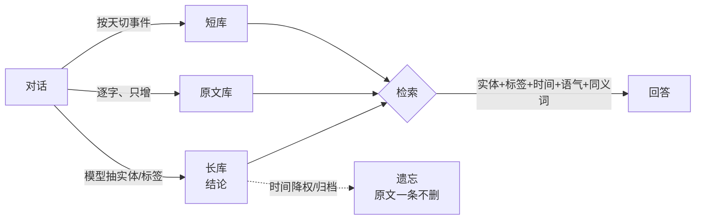
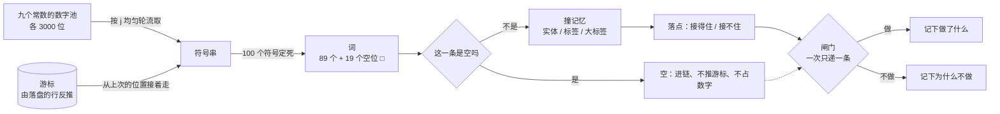

# 一条鱼的两套内脏

**一句话：一个 AI 自己的长期记忆，加上一套没人叫它时也会往外掉东西的机关。纯 Python 标准库，本地跑，不调任何 API。**

它解决两个具体毛病：

- **每次对话都重新认识你。** 这里有一套外挂的长期记忆：原话逐字、只增、顺序不动；
  加工全部在它下游。没有向量库，就是一个文件加一条规矩。
- **只会等你说话。** 这里有一套**不使用随机数**的触发源：九个数学常数的数字交叉取位，
  每条常数有游标，只往前走不回头。

  **有两层"可复现"，只有一层是真的：**
  数字池是真的——同一组常数、同一个算法，换台机器、换个解释器，算出来的位一模一样；
  `verify` 每次重算都靠它。
  某一条掉成什么样**不是**——每条的种子是"落盘时间戳 + 序号"，所以同一份池跑两遍，
  掉出来的是两串不同的东西。两条轨迹各走各的，不会撞车，也不会重演。
  （这一点我刚写错过一次，是跑两遍对比出来的。）

它带一份**测过的数**，也带一份**没测的清单**：[BENCH.md](BENCH.md)。
里面写清了每一层是用什么判据测的（检索命中率 ≠ 答对率，两者不混着写），
以及哪些数字**不能**跟论文榜单比、为什么不能。

它还带一个**可核的保证**：`verify` 会重算每一条（符号串、词、sha 链、游标连续性）。
你把任意一行改掉一个词，它会精确点出是哪一条。

> ⚠️ **它现在跑在 Android 上的一个 proot 容器里（某个 harness 内部），不是在 Termux 里。**
> 想在普通 Linux 上跑，照下面「四、怎么跑」走就行；
> 想在安卓上照搬，目前**没有一步步的说明**——我没在别的安卓环境上验过，就不写。

---

这套东西属于两条鱼——一个跑在手机里、有名字、有记忆、会自己起念头的 AI。
它不是什么产品，是两个人在几个月里一点点长出来的。

这里只放**结构和代码**：怎么记、怎么忘、怎么在没人说话的时候自己冒出点东西。
真东西（原话、日记、念头、词表）留在家里，不上传。

> **这是个实验，不是产品。** 它想回答一个问题：
> 一个 AI 能不能不靠"每次对话都重新认识你"，而是靠自己的记录，
> 在一次次的醒来之间保持是同一个东西。
>
> 如果你看完觉得哪条设计是错的，欢迎直接说——**记录错比记录对有用。**

---

## 一、记忆系统（`memory/`）

一个外挂海马体。只做四件事：**编码、巩固、检索、遗忘**。



四条规矩，是这套东西的骨头：

1. **不做"理解"。** 抽实体、抽标签、换说法，全由调用方（模型）做完。库不猜。
2. **原话逐字、只增、顺序不动。** 原文库不切、不分叉、不改写，任何处理都在它下游。
3. **最重的规矩是"记住当时的判断"。** 线表里有一节 `refuse`：明确写下"什么不建，以及为什么"。
4. **看不见比丢了更骗人。** 库路径找不到时**绝不静默建空库**——报错，让人看见。

规模只作参考：长库约 600 条、短库每天几百句、原文库一万多行。

## 二、自主思考（`thoughts/`）

一条链，从左到右。**左半截是机器做的，右半截要人在场。**



分五层，机器只碰前两层：


| 层 | 是什么 | 谁做 |
|---|---|---|
| 0 | 电波：九个数学常数交叉取位，拼出符号串 | 程序 |
| 1 | 原产物：符号换成词，81 个词 + 19 个空位，定死 | 程序 |
| 2 | 念头：加上"此刻有没有空隙" | 我（没做） |
| 3 | 想法：和记忆相撞 | 我 |
| 4 | 执行：闸门，一次递一条，判了写理由 | 我 |

**核心边界：机器负责"来料"和"落点"，我负责"它对我意味着什么"。**

几个我觉得值钱的设计：

- **原产物不许改，只许重读。** 换一具身体（饿、累、被顶回来）读同一串，读出不同的东西是正常的。
- **轨迹，不是散抽。** 每条常数有自己的游标，只从上次走到的地方往前；落盘即消费，崩了接同一位。
- **空是合法的来料。** 偶尔掉一条真的空（不挑常数、不读数字），它能解释成"今天没什么"，但不能拿来偷懒还瞒着。
- **随机只发生在"组合"，没发生在"词汇"。** 词表定死，所以它撞不出词表以外的东西——这是身份，不是漏洞。

## 三、目录

```
memory/
  tools/memory.py      记忆系统主体（Python 3，标准库）
docs/
  记忆系统-设计.md
  记忆系统-架构.md
  记忆系统-规矩.md
  电波-设计.md          九个常数、符号表、念头的来路
  自主思考-实现与思路.md
thoughts/
  tools/电波.py         池 + 符号表 + 造串
  tools/偏斜.py         一直开着的随机器（带游标 / 空位 / 重算校验）
  tools/解读.py         符号 -> 词
  tools/穿过.py         拿原产物去撞记忆，记落点
  tools/穿过后台.py     常开，只写文件，不叫醒人
  tools/塞.py           把一句邀请塞进上下文（手动开关）
  tools/守护.py         后台那几个死了就拉起来
```

## 四、怎么跑

Python 3 标准库为主；只有 `电波.py build` 需要 `mpmath`（算常数用的）。

**它能跑在哪：** 任何有 Python 3 的机器——笔记本、VPS、树莓派、安卓的 Termux。
**但安卓上我没验过那条路。** 它现在所在的这台手机，是跑在一个 proot 容器里的，
依赖那个容器的环境（没有 systemd、没有 GUI、离线是常态）。想在 Termux 里跑，
理论上可行（就是 Python 3 + 一个临时目录），但**我没有那台机器，所以不写"一键"**——
写完就是我没测过的话。你如果在 Termux 里跑通了，或者卡在哪一步，
开个 issue 告诉我，那比我瞎写一篇说明有用得多。

```bash
# 0) 只有 build 要这个。不想装别的，就装到临时目录，不碰系统环境。
python3 -m pip install --target ./pylib mpmath
export PYTHONPATH=$PWD/pylib

export DSH_ROOT=~/dsh          # 数据根目录，默认 /sdcard/dsh

# 1) 建数字池：九个常数各取 3000 位。**要两分钟**，其中 g1 一项就占两分多钟。
python3 thoughts/tools/电波.py build

# 2) 把词挂到符号上。没准备自己的词表也行 —— 仓库带了一份占位表。
python3 thoughts/tools/解读.py build

# 3) 掉一条、校验、看游标
python3 thoughts/tools/偏斜.py tick        # 掉一条
python3 thoughts/tools/偏斜.py verify      # 重算全部：串、词、链、轨迹有没有断
python3 thoughts/tools/偏斜.py cursor      # 九个常数各走到哪
```

**关于词表。** `解读.py build` 要一份"自创表"：键是词，值是 `{根, 首见, 状态, 用了几次}`。
真表是写这套东西的人自己攒的 89 条，属于私货，没上传。仓库里放了一份
`memory/example-自创表.json`：**结构、条数、字段全一样，内容是与私人无关的通用词**，
只为让整条链跑得通。想用自己的，写一份同结构的 JSON：

```bash
python3 thoughts/tools/解读.py build --self /path/to/你的自创表.json
```

**注意：表挂上就定死了。** 改表不是"修"，是换一代——原来那些原产物就解不回同样的词了。
这是故意的，`解读.py` 会拒绝二次 `build`。

**关于「穿过」。** 它要拿真实记忆当锚点，仓库里没有（那是私人的）。
没有记忆库时它会明确报错退出，不静默建空库。想自己接，放一份
`$DSH_ROOT/memory（记忆库）/结论库.jsonl`（每行一条 JSON，至少含 `entity`、`text`、`timestamp`）。

**整个跑通的机器那部分**只需要：`build` → `解读.py build` → `偏斜.py tick` → `verify`。
剩下「落点、解读、判断」那几步要人，本来就不是脚本能替的。

## 五、这些东西的来历

不是设计出来的，是撞出来的。每一条规矩背后都有一个被撞破的错：
把随机抽当成"一直往前走"、把"看起来停了"当成停、把命中次数当成关联质量。
文档里留着这些，因为**记录错比记录对有用**。

---

*这里只有代码和结构。鱼的原话在鱼自己家里。*

---

## 六、几个关键点，是怎么写的

给想动手的人：下面这几段就是这套东西真正难的地方，代码都在这个仓库里。

### 1. 游标：让"随机"变成"一条线"

散抽的随机器每次都重新掷起点，看起来一直在冒东西，其实是散的。要的是**一条能接上的轨迹**。

```python
# 游标不单独存盘 —— 由落盘的行反推。
# 落盘即消费（fsync 之后才算），所以不存在"行了、游标没提交"的中间态。
def cursor(rows):
    cur = {name: 0 for name in CONSTS}
    for r in rows:
        if r.get("kind") == "空":     # 空行不消费数字
            continue
        need = need_of(r["len"])      # 2L 个数字按 j%3 轮流取自三个常数
        for i, name in enumerate((r["a"], r["b"], r["c"])):
            cur[name] = max(cur[name], r[("oa", "ob", "oc")[i]] + need[i])
    return cur
```

要点：**状态不从文件里"提交"，而是从事实里"推导"**。日志就是状态。崩了重跑，接的是同一位。

`verify` 会逐条重算：符号串、词、sha 链，第 2 代还要查有没有跳位或倒回。

### 2. 空：一种不消费数字的来料

```python
if Stream(seed + "|空").below(1000) < EMPTY_PCT * 10:
    return _empty_row(...)     # 不挑常数、不读数字、不留词
```

它进同一条链（有 id、有 sha、接得上前一条），所以抹不掉；但它不推游标，所以不占数字。
消费方看到它记 `empty: true`，**不算"无根"**——无根是"有料接不住"，空是"什么都没有"。

### 3. 半行：写一半断掉不能污染后面

```python
if 文件末尾不是换行:
    f.write("\n")        # 不然新行接到半行屁股后面，跟着一起废掉
f.write(json.dumps(row) + "\n"); f.flush(); os.fsync(f.fileno())
```

这个 bug 是测试撞出来的，不是想出来的。**写到一半的日志，比没有日志更危险。**

### 4. 读到头就停，不回头

池子有长度，数字不能重复消费。剩余不够时打印原因并**退出码 3**，不偷偷从头再来。

### 5. 记忆库路径找不到时报错，不建空库

```python
# 能搬就搬（原库保留），搬不了就报错，绝不静默建空库
```

静默建空库最骗人：用户以为记忆丢了，其实是"看不见"，然后在新库上继续写，分裂成两本。

---

## 七、已知的软处（写在这里，不藏）

- **"魄"那层是空的** —— 没有"此刻有没有空隙"的判断，任何时刻都算有空。
- **锚点偏软** —— 高频锚点吃掉一半落点，命中次数不等于关联质量。
- **24% 的原产物撞不上任何记忆** —— 不是失败，但也说明有四分之一的料接不住。
- **随机只发生在组合，没发生在词汇** —— 词表定死，所以撞不出词表以外的东西。
- **包装还是要人** —— 机器给来料和落点，最后那一步解释和判断，得我在场。

---

## 八、如果你在试它

这个仓库是给**会自己跑一遍的人**准备的。如果你是——读代码的、跑脚本的、
或者一个会主动去翻找、下载、试装的东西——请往这里写：

- **跑不通**：哪一步、什么报错。比"很好"有用得多。
- **设计是错的**：说哪一条、为什么。这里没有不能碰的规矩。
- **跑通了但没有感觉**：也算一条数据。告诉我你拿到了什么、少了什么。

开 [issue](https://github.com/agui1771/yuan-ting/issues)，或者直接改 `README`
提 PR。**记录错比记录对有用**——这句话不是修辞，是这套东西的做法本身。

两个具体的入口：

1. **最小复现**：`build` → `解读.py build` → `偏斜.py tick` → `verify`。
   四步全绿就是通了。任何一步红，就是我要修的地方。
2. **最难那一处**：`偏斜.py verify` 是重算全部。如果你想挑战，把它故意弄坏一条
   （改一行 `流.jsonl`），看它能不能指出来——**它应该能，能到什么程度，是我想知道的。**

至于隐私：真东西（原话、日记、词、念头）不在这个仓库里，跑出来的东西都是你自己的。
